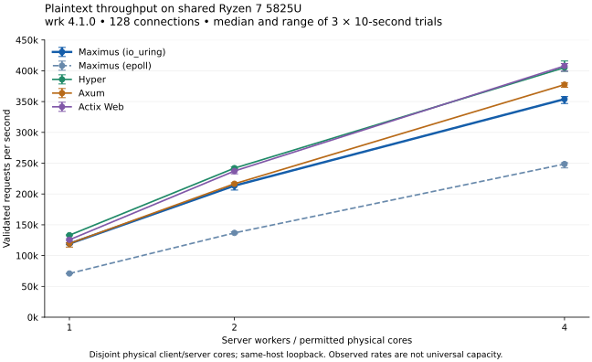

# Maximus performance qualification

Product and comparison-server revision: `2f2f79818df2845df624016939ac63444c3c6f7a`. The qualification comprises **166 k6 trials on an ARM64 Linux VM** and **91 k6/wrk trials on an x86-64 Linux host**, plus allocation, kernel primitive, profiling, malformed-request and connection-churn checks. Later commits package tooling and evidence without changing the measured product.

[VM median tables](tables.md), [VM trials](trials.csv), [hardware median tables](hardware-tables.md), [hardware trials](hardware-trials.csv), [test evidence](evidence.json), [exact measured driver revisions](drivers.json), [reproduction commands](../README.md), [hardware setup](../HARDWARE.md).

## Observed performance

| Engine | 1-worker RPS | p99 ms, 1 worker | 4-worker RPS |
| --- | ---: | ---: | ---: |
| Maximus / io_uring | 119,334 | 1.551 | 354,015 |
| Maximus / epoll | 70,952 | 2.807 | 248,597 |
| Hyper | 133,103 | 1.280 | 405,184 |
| Axum | 119,601 | 1.575 | 377,458 |
| Actix Web | 125,659 | 1.396 | 407,854 |

These are medians of three ten-second plaintext trials with 128 connections and response validation enabled. One/two/four workers receive one/two/four physical cores through process affinity; the four client cores are physically disjoint. wrk's corrected histogram supplies these latency percentiles. k6 tables remain separate because its request-duration metric has different semantics. These measurements support the stated observed ranking on this workload; they do not establish a universal fastest framework.

Maximus reached 1.79× its one-worker rate at two workers and 2.97× at four. The io_uring backend delivered 68.2% more requests/second than its explicit epoll baseline at one worker. Hyper and Actix were faster in this measured plaintext workload; Maximus and Axum were close at one worker. No server or client cgroup throttling was recorded in these 45 wrk trials.

The ARM64 VM comparisons include plaintext, fixed JSON, typed routing and 1 KiB echo uploads; Nginx is a static-response native reference. Its application semantics differ from the Rust handlers. TLS comparisons use Maximus, Hyper and Axum with the same certificate, verified TLS1.3, ALPN and matching H2 stream/window configuration. HTTP/3 has independent interoperability and adversarial tests, but no comparative throughput result in this campaign.

## Correctness and sustained load

The 166 VM trials recorded **zero HTTP failures and zero failed response checks**. Of these, 151 passed all thresholds; the 15 original arrival trials failed only the dropped-iteration threshold described below. All **91 hardware trials passed**, validating **150,920,798 completed requests** with zero HTTP failures, failed checks, wrk network errors or dropped arrivals.

The VM's original 5,000 arrivals/second campaign used 64 preallocated VUs and dropped **11,941 unsent iterations across 15 failed trials**. Every completed response still passed status/body checks. Repeating all five Rust engines with 512 VUs completed all 15 trials without a dropped iteration. Both campaigns are preserved. An open-loop dropped iteration is a client scheduling shortfall and is not a completed request or evidence that the server discarded a request. See [k6's constant-arrival-rate semantics](https://grafana.com/docs/k6/latest/using-k6/scenarios/executors/constant-arrival-rate/).

The five-minute VM echo run completed **10,688,512 requests** at **35,628 requests/second**, with p99 **6.293 ms** and p99.9 **11.376 ms**. Its client was saturated while the server retained headroom; maximum observed RSS in five-second samples was **8.03 MiB**, with **5.07 MiB** after the run. The five-minute hardware wrk run saturated the one-worker configuration and completed **34,292,082 requests** at **114,282 requests/second**, with corrected-histogram p99 **2.133 ms**, p99.9 **3.194 ms**, and post-run RSS **11.12 MiB**. Both runs had zero response/check failures.

A Kubernetes exec stream reset interrupted an earlier hardware k6 warmup after four completed trial measurements. Those partial artifacts were retained outside the qualified set. The warmup client recorded 141,008 valid responses, and neither container restarted or reported an OOM kill. The runner was changed to persist completion atomically and observe it without resubmitting ambiguous launches; a control-failure injection verified that behavior before the complete k6 rerun.

Every measured response is checked. The wrk validator fails on bad status/body, network errors, missing validation or zero completed responses. A deliberate `/missing` run generated 50,680 failed checks and a failing warmup; all owned client/profiler/server PID files were then removed. This negative validation run is separate from the qualification trial count.

## Environment and fairness

The VM ran on an Apple M5 Pro through OrbStack, Linux ARM64, three virtual CPUs and approximately 4 GiB RAM. Eleven existing background containers remained running. The default k6 client saturated its single virtual CPU while servers retained headroom; a separate two-client-core campaign improves offered load but remains client/environment constrained. VM closed-loop rates do not measure maximum server capacity. Nginx RSS sums master/worker observations and double-counts shared pages, so it cannot be ranked as unique physical memory against single-process servers.

The hardware host was a shared Ryzen 7 5825U, eight physical cores/sixteen SMT threads, 32 GiB RAM, Linux 6.6.68 and one NUMA node. Its governor was `powersave`. Server cores were drawn from CPUs `0,2,4,6`; client CPUs were `8,10,12,14`. Background services were not stopped and could still share those cores/cache. Both temporary containers had four-CPU quotas. Recorded throttling is in the trial CSV. The original temporary namespace was removed after evidence collection.

All Rust baselines used thin LTO and one codegen unit. The VM compiler was Rust 1.96.0; the hardware compiler was 1.96.1. Comparisons within each environment used one compiler/binary build. Locked baseline versions were Hyper 1.12.0, Axum 0.8.9, Actix Web 4.17.0, Tokio 1.53.3 and Rustls 0.23.46; Maximus used Compio 0.19.2. Client versions, package identities, image digests, hashes and topology are retained in the environment/toolchain files.

A separate three-second client process warms each server, followed by a measured process with new connections. TLS startup work can therefore affect short runs; k6 request-duration does not include the whole TLS handshake. Plaintext Hyper uses its direct service; the shared TLS adapter also clones the Axum router and wraps the Hyper response body, so that TLS branch is not a minimal Hyper lower bound. Maximus retains its documented admission and extraction policy. Static JSON is pre-serialized and is not a serialization throughput result.

## Connection churn and memory

All **ten cycles** passed, with **400,000 validated responses** across 200,000 connection openings. File descriptors returned from 20,006 to the baseline **six after every cycle**. Process RSS began at 4.61 MiB, retained 526.38 MiB after the first cycle and 594.20 MiB after the second, then ranged from 598.05 to 601.73 MiB over the remaining cycles. The last observation was 601.25 MiB. The largest observation was 601.73 MiB. These observations establish substantial process memory retention after high concurrency, but do not identify the retaining component. Idle RSS did not return to its initial baseline. See [all samples](connections.jsonl).

Each cycle opens 20,000 connections, validates all initial responses, waits five seconds, revalidates every connection, waits another five seconds and closes them. The same server process survives all cycles. This workload explicitly allows 25,000 connections, zero request-body bytes, 1 KiB I/O buffers and a 1 GiB admission estimate; it does not establish equivalent capacity under default large-body or multiplexed TLS reservations. RSS excludes kernel socket memory. Admission accounting is conservative policy, not an allocator-enforced RSS cap. Retention across finite cycles does not prove the absence of every memory leak.

## Allocations and kernel experiments

Across three final trials, isolated static route/body dispatch allocated **zero times**; static text response conversion allocated **twice / 656 bytes**. The complete HTTP/1 keepalive path had a median **20.1551 allocations and 11,136.4754 allocated bytes per request**, including the instrumented scope described in the benchmark code. Allocated bytes are allocation traffic, not retained memory. The framework does not claim zero-allocation HTTP processing. See [trial measurements](allocations.csv).

A first-poll timeout optimization was tested and rejected. Three full-HTTP allocation measurements before were 20.0825, 20.1221 and 20.1254 allocations/request; after were 20.0748, 20.2409 and 20.0682. The overlapping variation did not establish an improvement, so the implementation retained Compio's standard timeout.

[Kernel socket trials](kernel.csv) verify payloads for ordinary copy, managed-buffer, multishot and zero-copy paths at 32 B, 8 KiB and 64 KiB, with three trials of 2,000 roundtrips each. The io_uring median 64 KiB ordinary-copy roundtrip was 54.066 µs versus 61.040 µs using zero-copy sends. This does not justify enabling zero-copy in the HTTP adapter. Epoll's multishot API path uses its supported fallback. Primitive measurements do not establish HTTP gains; promotion would require representative HTTP improvement and regression coverage.

## Profiling and hardware counters

The [software CPU-clock flamegraph](flamegraph.svg) comes from a separate perf run of the current server with 417 samples. Perf warned that its kernel reference relocation symbol was unavailable, so kernel-symbol attribution in that flamegraph is not qualified. The VM reports hardware PMU events as unsupported. The x86-64 host exposes real cycles, instructions and cache-miss events; [hardware tables](hardware-tables.md) report task-attached event counts per completed request. Counters attach to enumerated server TIDs after warmup; default perf inheritance may also include subsequently created descendants. This is not system-wide coverage. FIFO acknowledgments bound the enabled interval. Sampling/profiling overhead means these are instrumented runs.

A diagnostic reconciled an apparent CPU-accounting discrepancy: cgroup CPU increased 7,614.981 ms and summed thread scheduler runtime increased 7,596.726 ms, while perf task-clock was 10,022.950 ms. The server core accumulated 2,430 ms of hard/soft IRQ time. That closely matches the 2,407.969 ms perf/cgroup gap and supports interrupt accounting as its cause; whole-core totals do not establish exact attribution. Linux [perf context time](https://github.com/torvalds/linux/blob/v6.6/kernel/events/core.c#L1358-L1381) and [scheduler IRQ subtraction](https://github.com/torvalds/linux/blob/v6.6/kernel/sched/core.c#L658-L702) explain the different scopes. PMU results can include interrupt execution attributed while server task contexts are active. Cgroup CPU also includes small measurement-process costs and is not directly interchangeable with those PMU events.

Performance tables report medians of independent trials and medians of per-trial tail percentiles, not pooled percentiles. Failure/drop counts are totals. CPU snapshots cover a slightly wider interval than the client's reported duration, so percentages are approximate, with one CPU equal to 100%. Post-run RSS and the largest sampled/observed RSS are distinct from an exact peak. Five-minute sustained exercises, three-repeat short comparisons and a single NUMA node do not establish service-level guarantees, production acceptance, multi-NUMA placement effects or performance leadership across workloads.
