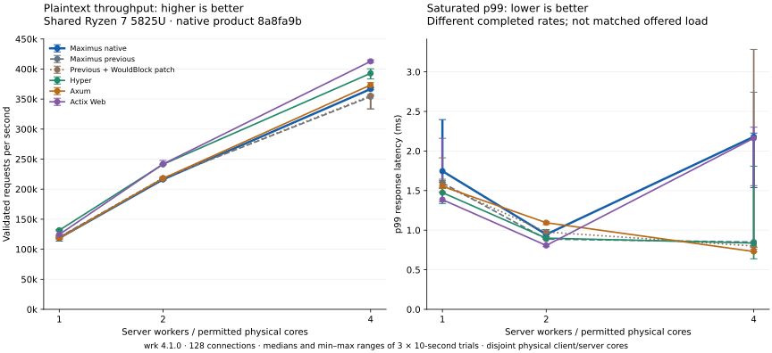

# Native HTTP comparison

The frozen implementation completed **217 primary cells and 215,599,359 checked responses**. Evidence integrity passed the independent audit; **193 workload targets passed and all 24 TLS arrival targets failed solely because scheduled iterations were dropped**. Native H2 achieved **19.2% lower plaintext and 17.3% lower echo throughput** than the archived Maximus engine in the matched 64-VU TLS test. Plaintext results do not establish universal throughput or latency leadership.

The product identity is `8a8fa9b23c652ae4b6e40fec6322cb9e094e22c9`. The build archive is `f85abcc841ee47c4d7739e21d669fd062112414b`, which changes only eleven Maximus path-package version entries in the comparison lockfile. Its 220-file source manifest has SHA-256 `cb6d3943987c4172b0a587f12deca0890580a75c6f229251a781b93d634a3fe4`. Later tooling commit `cb8bfc4` does not change this measured product. The actual retained measurement harness has SHA-256 `0f1fc2984af0707e72a6205f2a58ffc3347c2e7eb8ef7ee81882f8242905849f`.

The native benchmark binary has SHA-256 `40f63a86c04506cd9b677adc0eda84712e4530ebfbf3d14b9e6a14f8b55a62d2`. The old product uses archive `9cb096a27962a2966ca75b30e643f9e466c5cc4b` and binary `fb0cda74f3a847290b8733973cd67b213a9224dfdf7694703eb1ff56d00e25e7`. The WouldBlock baseline uses the same product with the isolated allocation-free Compio error constructor described in the opportunity report, binary `d8462020b24d6c6877b843df45e3ce3417164fd68e308bf8179322e434fe0eae`. This dependency patch is a diagnostic comparison and is not part of the frozen product.

The Linux x86-64 workspace all-feature test run passed 118 tests with zero failures and one ignored kernel BPF distribution test. That test requires capabilities absent from the owned Pod. The locked, offline release benchmark build passed, and all source manifest entries were verified before each timed phase. Host/ARM checks, fuzzing, protocol interoperability, and their separate evidence are documented in [the protocol qualification report](../../docs/native-http-qualification.md).

## Plaintext scaling

Entries are medians of three ten-second wrk trials with 128 connections and four client threads. Each trial starts a fresh server, runs a separate three-second warmup client, and rotates engine order by repeat. All 54 trials completed 130,400,069 measured responses with zero failed checks, network errors, or recorded throttling.

| Engine | 1 worker RPS | 2 worker RPS | 4 worker RPS | 4 worker p99 ms | 4 worker p99.9 ms |
| --- | ---: | ---: | ---: | ---: | ---: |
| Native Maximus | 118,687 | 216,212 | 366,730 | 2.180 | 5.706 |
| Original Maximus | 120,174 | 218,061 | 353,938 | 0.850 | 4.650 |
| WouldBlock Maximus | 119,633 | 218,303 | 355,474 | 0.800 | 4.737 |
| Hyper | 131,641 | 241,377 | 392,855 | 0.837 | 4.906 |
| Axum | 118,332 | 217,918 | 373,398 | 0.730 | 4.117 |
| Actix | 124,502 | 241,827 | 412,756 | 2.162 | 5.626 |

The native median changes against the original are -1.24%, -0.85%, and +3.61% at one, two, and four workers. Small differences with three shared-host repeats are descriptive measurements. The four-worker native range is 365,415–369,770 RPS, versus 333,741–355,269 for the original. Closed-loop latency is observed at different achieved rates, so its tail differences are not equal-offered-load comparisons. Separate 5,000/s arrival measurements are far below saturation and cannot settle near-capacity tails.

The batching gain reported separately compares the initial unbatched native prototype with the batched native prototype. It is not a 47–85% gain against the original Maximus/Hyper engine. Both saturated and low-load batching controls retain worse four-worker tails. The Date cache comparison is one-worker only. Exact measured and reviewed batching source hashes differ solely by a comment and a Clippy lint annotation; the reconstructed measured source and exact diffs are retained.

## k6 workloads and TLS

The plaintext matrix uses one worker and 128 VUs. Values are median achieved RPS across three trials, with exact status/body/protocol validation. All 60 trials completed 28,027,459 checked responses. These fixed-client results are kept separate from the wrk scaling rates.

| Engine | Plaintext RPS | JSON RPS | Typed route RPS | 1 KiB echo RPS |
| --- | ---: | ---: | ---: | ---: |
| native | 46,812 | 47,589 | 48,205 | 43,202 |
| baseline | 46,611 | 47,303 | 47,353 | 42,775 |
| hyper | 47,939 | 48,221 | 48,471 | 43,991 |
| axum | 47,678 | 48,630 | 47,896 | 43,449 |
| actix | 48,321 | 48,122 | 48,384 | 43,247 |

Both primary TLS protocols use one worker and 64 VUs. HTTP/1.1 completed 24 trials / 10,435,846 checked responses; HTTP/2 completed 24 / 9,189,176. TLS is 1.3. Actix has no TLS branch in this comparison driver and has no TLS result here.

| Protocol | Engine | Plaintext RPS | Echo RPS | Plaintext p99 ms | Echo p99 ms |
| --- | --- | ---: | ---: | ---: | ---: |
| H1 | native | 46,179 | 41,552 | 6.959 | 8.009 |
| H1 | baseline | 45,066 | 40,323 | 7.247 | 8.197 |
| H1 | hyper | 45,735 | 41,937 | 7.559 | 8.017 |
| H1 | axum | 46,476 | 41,547 | 7.041 | 8.258 |
| H2 | native | 36,456 | 26,973 | 6.075 | 7.888 |
| H2 | baseline | 45,143 | 32,598 | 6.237 | 7.862 |
| H2 | hyper | 49,928 | 35,473 | 5.656 | 8.125 |
| H2 | axum | 46,570 | 33,444 | 6.343 | 7.554 |

Native H2 achieved about 19.2% lower plaintext and 17.3% lower echo medians than the archived Maximus engine under this matched 64-VU setup. The result is retained as a material performance regression. A small separate paired user-CPU profile may show executed hot paths; it does not establish the cause of the throughput gap.

## Fixed-arrival targets

The plaintext control offered 5,000/s with 512 preallocated VUs at one and four workers: 30 cells, 1,499,950 checks, zero drops/errors. Native versus old Maximus median p50/p99/p99.9 were 0.0890/1.557/6.454 versus 0.0998/1.212/4.460 ms at one worker, and 0.0769/0.906/3.262 versus 0.0821/1.175/18.076 ms at four workers. This mixed low-load result cannot resolve near-capacity tails. The installed wrk 4.1.0 has no rate-control option.

TLS H1/H2 offered 5,000/s with 64 preallocated VUs, one worker, four engines, and three ten-second repeats. Every cell failed the zero-drop target: **2,498 drops and 1,197,497 checked completed requests**. The frozen harness exited on each failure; a separate outer driver continued only after independently validating that drops were the sole failure. Each logical cell has a unique label, raw repeat=0, and separately retained experiment_repeat. No failed cell was selectively rerun. The latency values below are conditional on completed requests in failed target trials.

| Protocol | Engine | Checked requests | Drops (three trials) | Median p50 ms | Median p99 ms | Median p99.9 ms |
| --- | --- | ---: | ---: | ---: | ---: | ---: |
| H1 | native | 149,724 | 279 | 0.0942 | 0.431 | 3.283 |
| H1 | baseline | 149,780 | 218 | 0.0963 | 0.365 | 2.196 |
| H1 | hyper | 149,666 | 328 | 0.0746 | 0.284 | 7.274 |
| H1 | axum | 149,658 | 346 | 0.0790 | 0.418 | 5.117 |
| H2 | native | 149,599 | 400 | 0.1522 | 0.448 | 6.677 |
| H2 | baseline | 149,754 | 246 | 0.1392 | 0.369 | 3.485 |
| H2 | hyper | 149,644 | 355 | 0.0997 | 0.333 | 6.501 |
| H2 | axum | 149,672 | 326 | 0.1028 | 0.327 | 8.880 |

The initial native H1 arrival attempt at 64 VUs (101 drops/49,900 checks) and bounded 112-VU sizing attempt (64 drops/49,937 checks) remain separate failed diagnostics. Sizing stopped before H2. Aggregate summaries do not establish each drop’s timing or cause.

## Buffering strategy and bounded size sweep

The isolated [write batching experiment](native-http-write-batching.md) tested the 16 KiB buffer with separate fixed head/body writes versus bounded coalescing and buffer reuse, plaintext 13-byte responses and 1 KiB echo, at one/two/four workers. Gains of 47–85% compare native prototypes; they are not gains against old Maximus. Four-worker tails worsened at saturation and at 5,000/s. The [Date cache experiment](native-http-date-cache.md) is one-worker only. Exact measured/reviewed batching source differences are a comment and lint annotation; runtime code is identical. Neither experiment isolates TLS batching or measures streaming throughput.

The separate size sweep completed **36 cells and 6,414,454 checked responses**, with zero failures/drops and started=completed=requests in warmup and measurement. It tests the final writer at 4/16/64 KiB buffers, plaintext H1 and TLS H1, 1/128 KiB echo, one worker and 64 VUs, three rotated repeats, three-second warmup and eight-second measurement. One diagnostic main adds an `IO_BUFFER_BYTES` override, validates Limits and capacity, and prints the configuration; frozen libraries and defaults are unchanged. Logical admission capacities range from 3,382 to 3,971 connections, exceeding 64 VUs; these are reservation estimates, not resident allocations.

| Protocol | Echo body | 4 KiB RPS [min–max] | 16 KiB RPS [min–max] | 64 KiB RPS [min–max] |
| --- | ---: | ---: | ---: | ---: |
| Plain H1 | 1 KiB | 43,591 [42,822–44,152] | 43,470 [43,129–43,928] | 42,377 [40,708–42,540] |
| Plain H1 | 128 KiB | 2,714 [2,665–2,766] | 5,303 [5,290–5,325] | 5,311 [5,286–5,400] |
| TLS H1 | 1 KiB | 39,310 [38,221–39,896] | 38,928 [38,273–39,790] | 38,673 [35,024–39,501] |
| TLS H1 | 128 KiB | 2,068 [2,061–2,190] | 3,209 [3,142–3,293] | 3,711 [3,693–3,783] |

For 128 KiB echo, moving 4→16 KiB raises median RPS by 95.4% in plaintext and 55.1% in TLS. Moving 16→64 KiB changes plaintext by +0.14% and TLS by +15.65%; plaintext p99 also worsens from 20.69 to 25.08 ms. For 1 KiB bodies, 4/16 KiB rate ranges overlap; 64 KiB has a lower plaintext range, while the TLS ranges overlap. At 128 KiB bodies, median RSS grows across 4/16/64 KiB from 12.4/14.4/20.3 MiB plaintext and 18.4/23.6/35.4 MiB TLS. These observed throughput/latency/memory tradeoffs do not select a universal buffer size.

These are buffer-size observations on the final batching strategy, not isolated TLS batching attribution or an exhaustive optimum. No default was tuned from the sweep. Latency, RSS, CPU sample intervals, and raw counts remain in the [36 trial rows](native-http-buffer-sweep.csv) and [12 summaries](native-http-buffer-sweep-summary.csv). Validation-heavy k6 throughput can be client-limited.

The derived main SHA-256 is `ac7407704c354e4c94c3e209f9c21ee759c937b934b79fc29e4842f3a6e08cbf`, the exact patch `3fdb7369cfcbb359933b20f3f6696ca7e882fd19fd1badf214c3277fbb9fa043`, current runner `ae7662027270cecdd9137ec8f53a8f605f51e634bb475245bbd316aefeea3f4e` and base workload `85099804db4a0da62e67d417684f335ae80073896952bb125f1fa3e9950a3376`. The 222-entry derived manifest verifies all frozen source entries except that exact main patch plus the explicit binary/wrapper. A failed preparation upload produced an empty main and failed compilation before measurement; a later staging SHA-read call failed before measurement. Both attempts remain retained, and verified staging resumed without rerunning timed cells.

## Allocations and resident memory

Three alternating runs per variant measure 10,000 complete HTTP/1 keepalive requests per run, including client and server allocations under process mask `0,8`. Values are medians; requested bytes are allocation traffic, not retained heap. Static route/body dispatch stays at zero allocations; static text conversion stays at two allocations and 656 bytes.

| Variant | Allocations/request | Requested bytes/request |
| --- | ---: | ---: |
| baseline | 30.9828 | 12,705.2898 |
| baseline-wouldblock | 18.9874 | 12,413.2512 |
| native | 15.9986 | 3,081.3616 |

Ten native cycles each opened 20,000 plaintext connections, validated a response, held them five seconds, revalidated a second response, held another five seconds, then closed them: **400,000 checked responses**. FDs returned to six after every cycle. The diagnostic uses 25,000 connection admission slots, 1 KiB I/O buffers, zero request-body allowance, 8 KiB headers, 1 GiB logical memory budget and 300-second header/idle deadlines. It is a high-connection retention test, separate from default workload limits. The archived observer ran three cycles / 120,000 checked responses; this native run extends duration. Only its first three cycles have the same cycle count, and no ten-cycle archived comparison is claimed.

After close, live Rust requested bytes ran from 912,114 in cycle 1 to 1,207,026 in cycle 10 (range 912,114–1,207,026); RSS ran from 234.7 to 235.0 MiB. The System-forwarding allocator uses atomic counters without allocation maps. Its live requested bytes exclude C allocations, mmap, stacks and kernel buffers; RSS alone cannot classify an allocator leak. All 32 allocator/RSS/PSS/anonymous samples remain in [the churn CSV](native-http-churn.csv).

Closed-cycle live requested bytes stayed at 912,114 through cycles 1–8, then stepped upward by 294,912 bytes (288 KiB) for cycles 9–10; RSS rose 272 KiB. This is not a literally flat live-heap series, and the cause of the small step is unresolved. The archived three-cycle observer had live 908,829 bytes after each close and RSS 526.3/590.8/601.4 MiB, versus native first-three live 912,114 bytes and RSS 234.7 MiB each. These separately timed diagnostics show that retained RSS greatly exceeds live Rust requested bytes in both implementations; they do not prove an allocator leak is absent or establish a matched ten-cycle memory comparison.

A separate five-minute, one-worker plaintext reuse run completed 34,849,362 checks at 116,148 RPS, p50/p99/p99.9=1.073/1.726/2.808 ms, no errors/drops/throttling. All 51 RSS samples were 10,240 KiB. This single run is separate from the three short scaling repeats and from churn.

## CPU profiles and runner qualification

profile: 590 actual samples, 0 lost, 112 unknown leaves; leading sampled leaves: `[unknown]` (112 samples); `<compio_runtime::time::future::TimerFuture as core::future::future::Future>::poll` (59 samples); `__vdso_clock_gettime` (24 samples).

profile-h2: 702 actual samples, 0 lost, 116 unknown leaves; leading sampled leaves: `[unknown]` (116 samples); `__vdso_clock_gettime` (32 samples); `malloc` (30 samples).

profile-h2-baseline: 872 actual samples, 0 lost, 153 unknown leaves; leading sampled leaves: `[unknown]` (153 samples); `h2::proto::connection::Connection<T,P,B>::poll` (44 samples); `<compio_runtime::time::future::TimerFuture as core::future::future::Future>::poll` (27 samples).

These separate one-worker profiles use user-space cpu-clock at 99 Hz and DWARF 16 KiB stacks, excluding kernel/IRQ samples. H2 native and old use identical 64-VU TLS plaintext clients, three-second warmup, 15-second measurement and 25-second capture options; native H1 uses wrk 128 and a 20-second capture. Folded stacks and SVGs weight cpu-clock periods in nanoseconds; their original metadata field named folded_samples is not a sample count. A separate raw-header audit supersedes the original sample-count, symbol-coverage and unknown-leaf metadata fields. Small stack counts and profiling overhead do not establish the cause of the H2 regression or a causal ranking of optimization costs. Full data, scripts, folded stacks, reports and SVGs remain retained.

The current published runner also passed a separate positive live CLI smoke: one native worker, 64 VUs, plaintext, three-second warmup and two-second measurement; 91,415 starts=completions=checked requests, zero failures/drops. Server/client monotonic CPU sample intervals were 6.810/6.810 seconds. This smoke is outside the 217 primary cells and does not retroactively add its counter gate to historical measurements.

## Limits, exclusions and reproduction

These are sequential, loopback measurements on the shared Ryzen 7 5825U homelab node, with rustc 1.96.1, thin LTO, one codegen unit, logical CPU IDs mapped to disjoint physical server/client cores, and four-CPU quotas per container. Server process masks use logical CPU IDs `0,2,4,6` as worker count increases; client masks use `8,10,12,14`. Other host workloads, frequency control, interrupt sharing, and scheduling remain uncontrolled. Only one owned benchmark load ran at a time, and no remote compilation overlapped timed trials.

Native and old Maximus use the same configured limits and deadlines. The native parser intentionally rejects some ambiguous framing that the old engine accepted, as documented in the protocol qualification report. The Tokio framework drivers do not implement a fully equivalent Maximus lifecycle, deadline, and resource policy. The earlier synthetic dispatcher measurements give partial cost attribution, not an equivalent-policy Tokio server qualification. k6 comparisons use status, exact body, and expected protocol checks on every response. Validation-heavy k6 client CPU can limit achieved throughput; its rates are not independent measurements of server capacity. wrk and k6 latency distributions use different measurement semantics and are kept separate.

Client-reported plaintext intervals span 10.019–10.100 seconds, while the surrounding acknowledged control intervals span 11.561–13.315 seconds. Cgroup CPU includes server-container control activity across that wider interval; perf attaches to server threads. The preserved CSV formula is `CPU_percent = 100 × wider cgroup CPU delta / client-reported duration` in matching units. `cpu_us_per_request = wider cgroup CPU delta in microseconds / checked request count`. The percent fields are not wall-normalized utilization or proof of sustained CPU quota saturation. The current tracked runner corrects its utilization denominator; these historical fields are not retroactively rewritten. Perf task-clock is 1.294–1.454 times the cgroup CPU delta in these trials, an unresolved accounting disagreement. Recorded counters divided by validated responses must not be described as exact client-only CPU time or pure application instruction counts. No CPU-efficiency conclusion relies on treating those two accounting scopes as interchangeable.

The initial TLS throughput commands used 128 VUs. H1 completed 24 clean supplementary trials. H2 native and old reserve 36,536,320 logical bytes per connection under these defaults, admitting 117 connections from 4 GiB; eleven VUs remained pending and the clients used the full 30-second grace extension. Their completed checks did not qualify unfinished iterations. Those three completed H2 rows and partial work are excluded; all primary TLS throughput cells were rerun at 64 VUs under new labels. No product changed.

The [primary phase map](native-http-phases.json) names every included label. [217 raw trial rows](native-http-trials.csv) retain failed target rows; [72 short summaries](native-http-comparison.csv) exclude the [one sustained run](native-http-soak.csv). Preliminary failed arrival, supplementary H1=128 and excluded H2=128 attempts have separate CSVs. Independent primary and buffer auditors read local retained evidence. Exact per-label commands, environments, binary/source hashes, source verification, client summaries, snapshots and PMU outputs are under `artifacts/native-http/qualification/`; independent audits are under `artifacts/native-http/reviewer/`. Raw artifacts are excluded from Git.

Reconstruct the source with `git archive f85abcc841ee47c4d7739e21d669fd062112414b` into a separate directory. Release build: `CARGO_TARGET_DIR=/work/target cargo build --manifest-path benches/baselines/Cargo.toml --release --locked --offline`. X86 test: `CARGO_TARGET_DIR=/work/native-test-target CARGO_PROFILE_DEV_DEBUG=0 CARGO_PROFILE_TEST_DEBUG=0 cargo test --workspace --all-features --locked --offline`. Per-label `*-command.json` files record exact timed CLI arguments and owned Pod/tool paths. Later published runner improvements create a separately identified campaign when rerun.

## Evidence retention and cleanup

After independent review and local raw retention, only the owned `maximus-native-9cb096a-opportunities` namespace in context `homelab` was deleted and verified NotFound at 2026-10-16T15:55:21.293425+00:00. Exact delete/absence commands and responses are retained in `artifacts/native-http/qualification/cleanup-evidence.json`. The local 127,119,360-byte source/raw/profile/binary archive is `remote-native-measurements.tar`, SHA-256 `151c8fe92ff7b4575c566d782e45a8e378022a1221461dce6030e29c6138c41e`; remote/local hashes matched before deletion. Separate raw files, all failed attempts, perf data, corrected SVGs, source patches and retained binaries remain locally. Historical remote paths require a newly staged owned Pod to reproduce. No other namespace or existing Docker container was changed.
